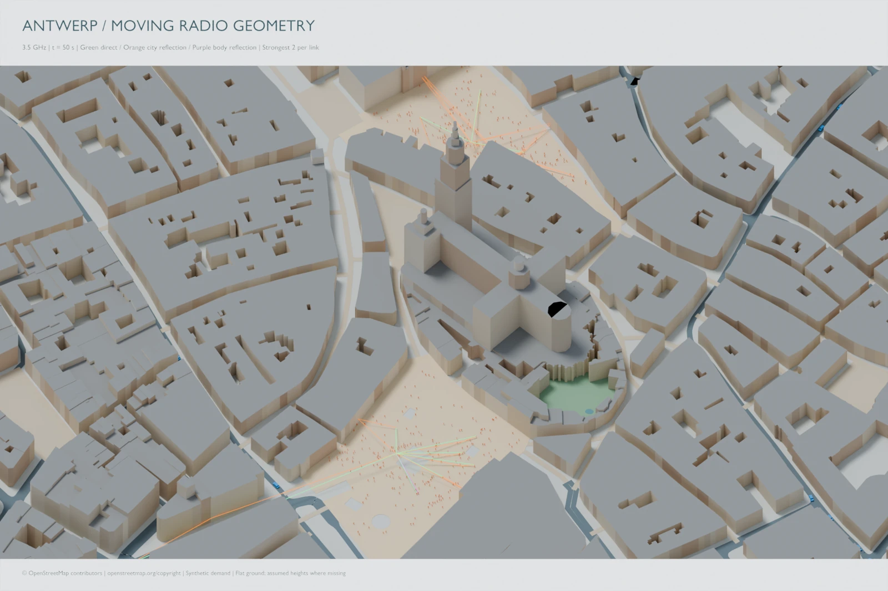

**Availability: local research demonstration.** The figure below is from the Antwerp Mobility 0.6 moving-body example.

{fig-alt="Antwerp city geometry and simulated radio paths at 50 seconds"}

Geographic data: © [OpenStreetMap contributors](https://www.openstreetmap.org/copyright), [ODbL](https://opendatacommons.org/licenses/odbl/1-0/). Mobility demand is synthetic.

## What is connected

OSM city geometry, JuPedSim pedestrians and SUMO vehicles share a coordinate system and Blender timeline. Receivers follow selected agents. The radio companion exports moving body geometry and solves selected frames with Sionna RT.

## Reading this figure

The displayed snapshot is at 50 seconds and 3.5 GHz. Green lines indicate direct paths, orange lines city reflections and purple lines body reflections. The presentation displays the strongest two paths per linked pair; it is not a display of every computed path.

The original 0.6 demo has native radio solutions at 10, 30 and 50 seconds. Smooth mobility playback between those instants does not mean a radio solution was computed at every animation frame.

## Assumptions

The city uses flat ground and assumed building properties where data is missing. Simplified bodies represent pedestrians and vehicles. The documented run considers line of sight and specular reflections, with translational Doppler. Pedestrian and vehicle demand are not observations of real traffic, and the two mobility simulators do not jointly resolve cross-population collisions in this example.

The 0.6 CPU environment is documented separately from the public SionnaRT-Bridge CUDA release. Use the demo’s pinned runtime and companion when reproducing it.

## Further local studies

The inspected Mobility Bridge source also contains hovering-UAV, traffic-jam, evacuation, UAV placement and Skybrush receiver examples. These are candidates for dedicated pages with their own figures, exact version records and downloadable reproduction bundles.

This starter presents the existing city render; it does not distribute the local simulation caches or claim a public download for the later studies.
