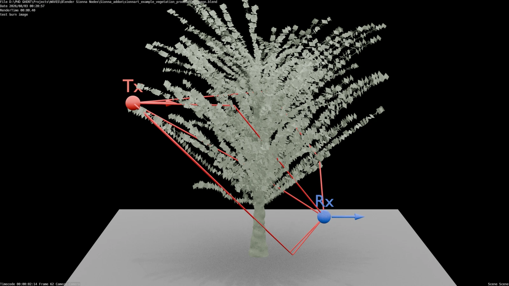
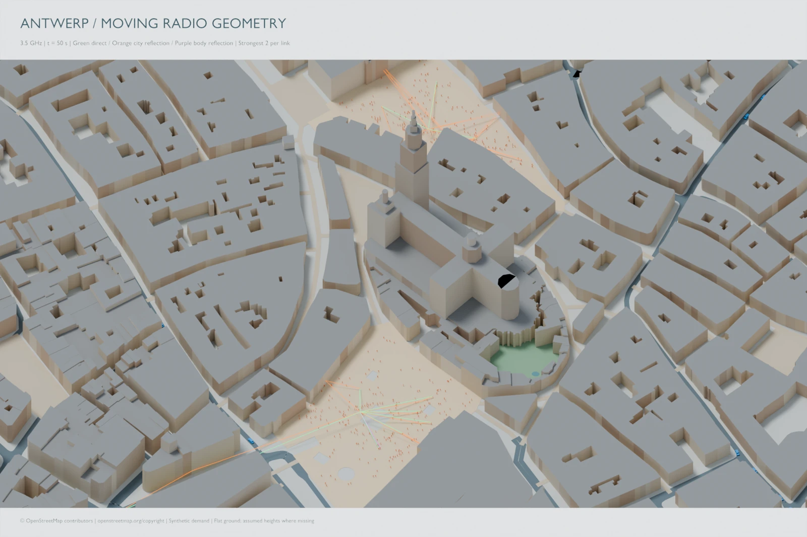
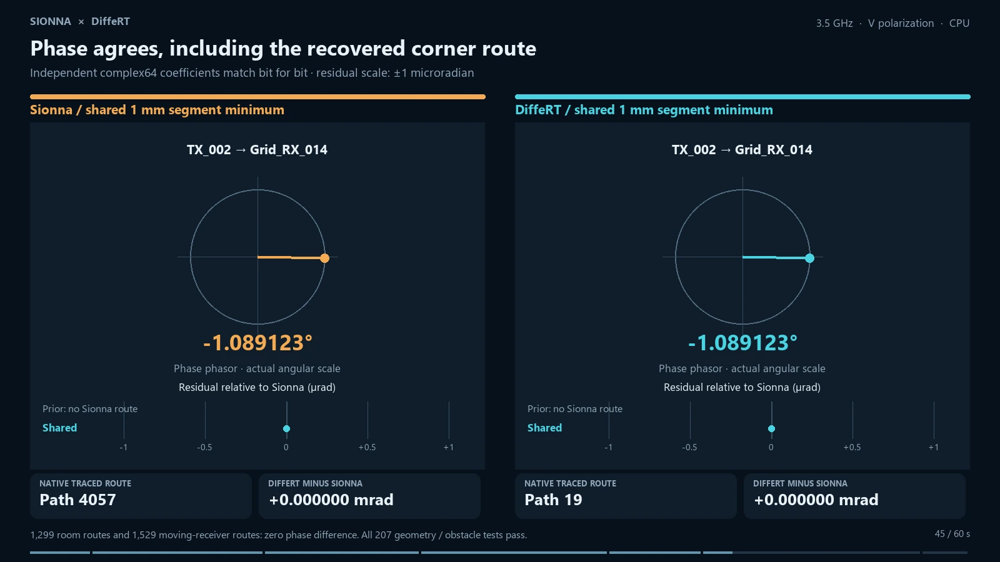

Start with a public scene, or inspect the local research demonstrations. Availability is stated separately from scientific validation.

## Procedural vegetation

{fig-alt="Procedural Blender vegetation and simulated propagation paths"}

**Public scene.** Follow changing vegetation geometry through scene evaluation, simulation and visualization. [Explore the example →](vegetation.qmd)

## Antwerp mobility and radio

{fig-alt="Antwerp moving-body radio demo"}

**Local research demo.** Bring together OSM geometry, synthetic mobility and sampled radio solutions. [Explore the city workflow →](antwerp.qmd)

Geographic data: © [OpenStreetMap contributors](https://www.openstreetmap.org/copyright).

## Sionna and DiffeRT

{fig-alt="Comparison of Sionna and DiffeRT"}

**Local comparison.** Watch a one-minute explanation of the shared-segment comparison and learn why matching solver assumptions matters. [Watch the comparison →](engine-comparison.qmd)
