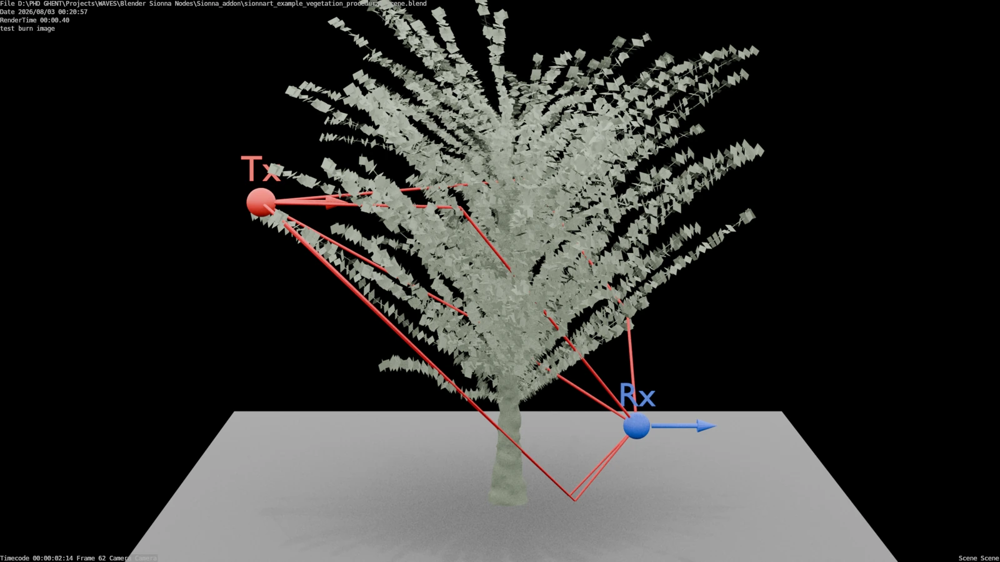

**Availability: public Blender example.**

{fig-alt="Procedural vegetation and Sionna RT propagation paths"}

## Question

How does a change in procedural vegetation geometry affect the simulated propagation paths between a transmitter and a receiver?

## Workflow

The supplied Blender scene includes the procedural plant, devices, settings and imported paths. SionnaRT-Bridge evaluates the geometry at sampled frames, exports the scene state and returns paths as attributed geometry for display.

This creates a natural tutorial: first inspect the provided result, then rerun a baseline and change one geometry parameter.

## Use the example

[Open the public example and scene files](https://github.com/fribas001/sionnart-bridge/tree/main/examples/procedural-vegetation-paths)

Keep the scene, supporting files and checksums together. Follow the [first-scene workflow](../tutorials/first-scene.qmd) for setup and result recording.

## Interpretation

This image illustrates an example scene and its path visualization. The repository distinguishes historical example assets from its current vegetation validation dataset. Use the [vegetation reproducibility record](https://github.com/fribas001/sionnart-bridge/tree/main/reproducibility/vegetation) for the separate study’s evidence and settings.
