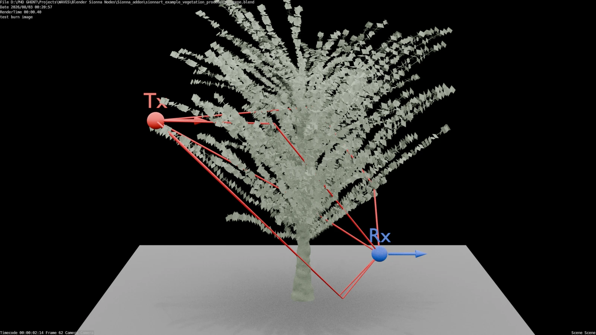
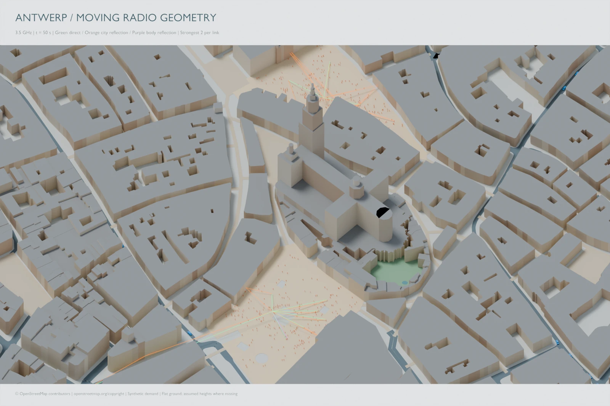
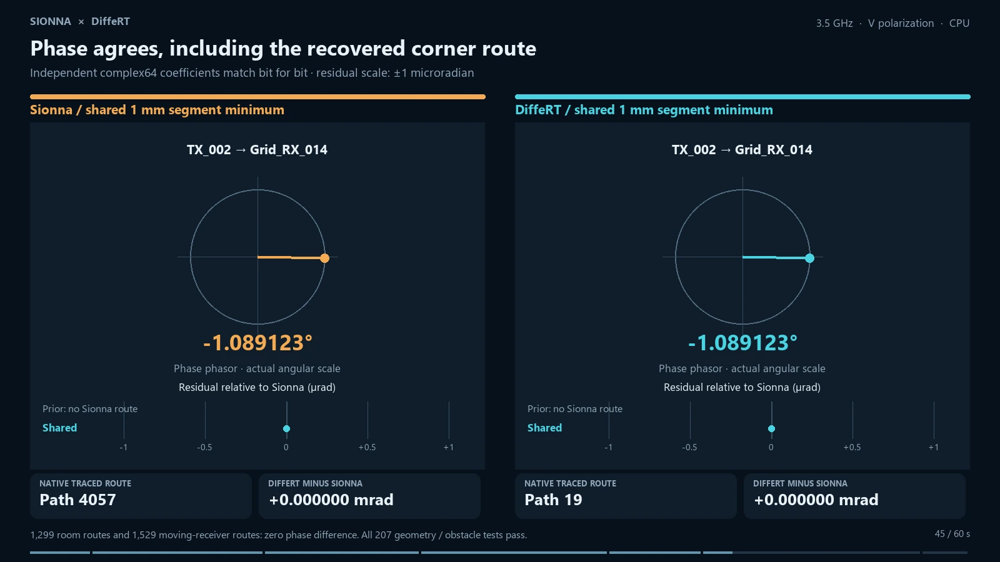

```{=html}
<div class="home-content">
  <section class="hero" aria-labelledby="hero-title">
    <div>
      <p class="eyebrow">Felipe Oliveira Ribas · Scientific computing</p>
      <h1 id="hero-title">Radio simulation,<br><span>made visible.</span></h1>
      <p class="lead">Build scenes in Blender. Trace propagation with Sionna. Explore how geometry, materials and motion shape radio channels.</p>
      <p>Software, worked examples and visual explanations for RF and electromagnetic simulation.</p>
      <div class="actions"><a class="action primary" href="tutorials/first-scene.html">Start with a scene →</a><a class="action" href="software.html">Explore the software</a></div>
    </div>
    <figure class="hero-media"><a href="examples/vegetation.html"></a><figcaption>Procedural vegetation and propagation paths · SionnaRT-Bridge.<br>A scene example; see the project’s separate validation and reproducibility records.</figcaption></figure>
  </section>

  <div class="section-intro"><h2>Explore the work</h2><a href="examples/index.html">Browse all examples →</a></div>
  <p>From procedural geometry to moving receivers and comparisons between propagation engines.</p>
  <div class="project-grid">
    <article class="project"><a href="examples/vegetation.html"></a><span class="status">Public example · SionnaRT-Bridge</span><h3><a href="examples/vegetation.html">Procedural vegetation</a></h3><p>Evaluate a changing plant, solve selected frames and bring the paths back into Blender.</p></article>
    <article class="project"><a href="examples/antwerp.html"></a><span class="status">Local research demo · Mobility Bridge</span><h3><a href="examples/antwerp.html">Radio in a moving city</a></h3><p>Align city geometry, pedestrian and vehicle motion, and sampled radio solutions.</p></article>
    <article class="project"><a href="examples/engine-comparison.html"></a><span class="status">Local comparison · DiffeRT-Bridge</span><h3><a href="examples/engine-comparison.html">Compare two engines</a></h3><p>Inspect paths, coverage, motion and phase with explicitly aligned comparison settings.</p></article>
  </div>

  <div class="workflow-strip" aria-label="Research workflow">
    <div><strong>01 / Build</strong><p>Author geometry, materials and animation in Blender. Preserve the editable scene.</p></div>
    <div><strong>02 / Simulate</strong><p>Run the appropriate solver with recorded versions, parameters and assumptions.</p></div>
    <div><strong>03 / Explain</strong><p>Publish figures, videos and reproducible examples alongside the code.</p></div>
  </div>

  <section class="watch-section" aria-labelledby="talk-title">
    <p class="eyebrow">From the Blender Conference</p>
    <h2 id="talk-title">Building Procedural Simulation Environments</h2>
    <p>Watch the BCON26 talk, starting at the selected moment.</p>
    <iframe class="video-frame" src="https://www.youtube-nocookie.com/embed/tUAMVAh3OMo?start=1720" title="Building Procedural Simulation Environments — BCON26" loading="lazy" allow="accelerometer; clipboard-write; encrypted-media; gyroscope; picture-in-picture; web-share" referrerpolicy="strict-origin-when-cross-origin" allowfullscreen></iframe>
    <p class="video-note"><a href="https://www.youtube.com/watch?v=tUAMVAh3OMo&amp;t=1720s">Open on YouTube at 28:40</a> · <a href="talks.html">All talks, including CT-scanned insect models →</a></p>
  </section>
  <p class="home-note">Geographic imagery: © <a href="https://www.openstreetmap.org/copyright">OpenStreetMap contributors</a>. City motion is synthetic. Each case study states its model assumptions and scope.</p>
</div>
```
